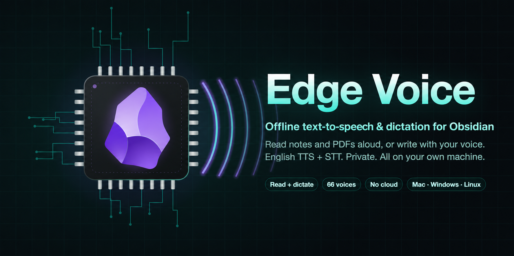
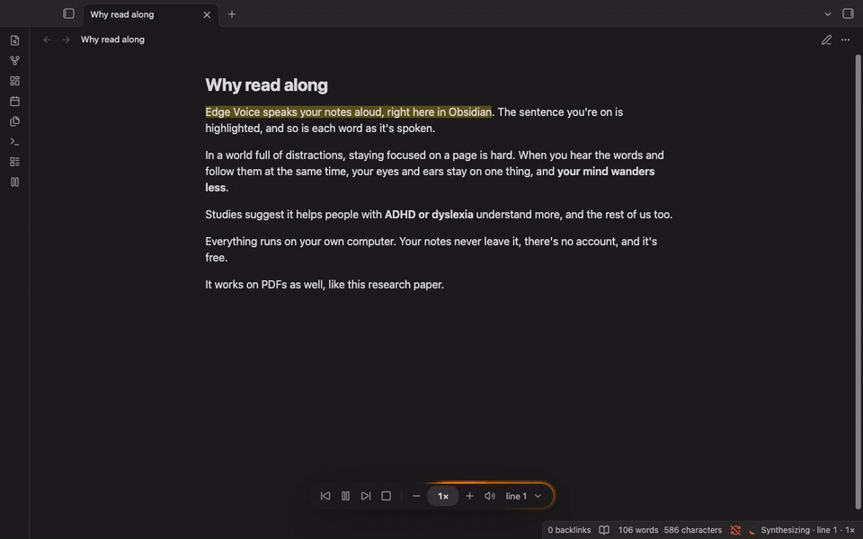
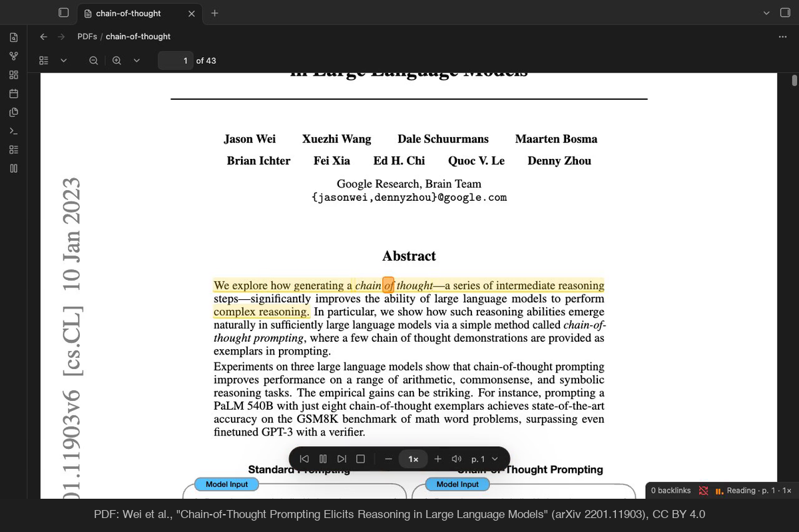
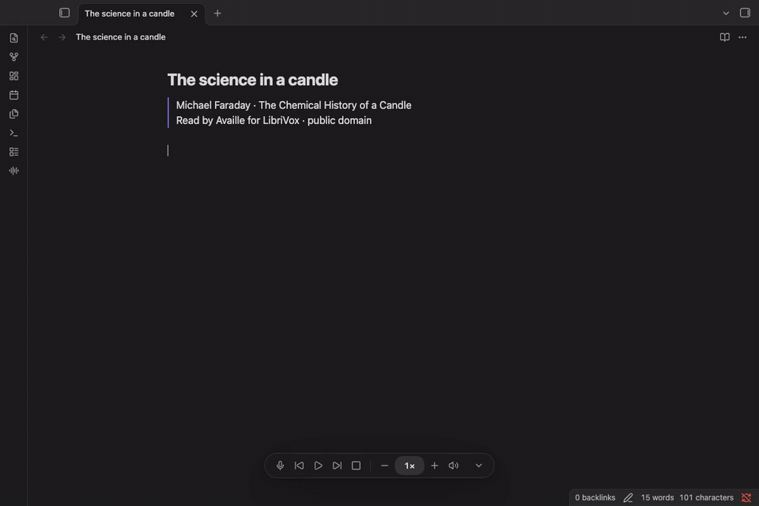

<p align="center"></p>

# Edge Voice

**Local text-to-speech (TTS) and English dictation (STT) for Obsidian: read notes and PDFs aloud, or write Markdown with your voice.**

> Release preparation: this checkout targets plugin **0.2.0** and engine **0.4.0**, for the upcoming stable release. Opt-in prereleases are listed on the [GitHub releases page](https://github.com/tattorba87/obsidian-edge-voice/releases); the stable Community version remains TTS-only. For testing before publication, use the [isolated development setup](docs/experimental-dictation.md).

**Free. Private.** Free and open source (MIT), with no account, no subscription and no limits. Speech synthesis and recognition run on your own computer: your notes and microphone audio stay local, and once it's set up it works offline.



▶ **[Watch the demo with sound](https://github.com/user-attachments/assets/fb9d0ba1-60dc-46e0-a5a7-1c8fc0d4d4ee)**

<sub>The paper in the demo: Wei et al., [Chain-of-Thought Prompting Elicits Reasoning in Large Language Models](https://arxiv.org/abs/2201.11903) (2022), CC BY 4.0. Recorded on an Intel Mac with pauses for synthesis cut; on Apple silicon the next sentence is ready in time.</sub>

- **Read along.** The sentence and the word being spoken are highlighted as you listen, in notes (editing, Live Preview and Reading view) and in PDFs.
- **Natural voices.** 66 English voices, American and British, from [Kokoro](https://huggingface.co/hexgrad/Kokoro-82M) and [Piper](https://github.com/rhasspy/piper). On Apple silicon, a faster engine runs the Kokoro voices on the GPU.
- **Write with your voice.** Dictate English into a Markdown note with a microphone button or Left ⌘ double tap. Local streaming recognition, optional sounds, lowercase output and automatic stopping.
- **Start anywhere.** Right-click a sentence and choose _Start text-to-speech here_. Pause, skip sentences and change the speed from the player bar.



<sub>PDF: Wei et al., "Chain-of-Thought Prompting Elicits Reasoning in Large Language Models" ([arXiv 2201.11903](https://arxiv.org/abs/2201.11903)), [CC BY 4.0](https://creativecommons.org/licenses/by/4.0/).</sub>

English only for now. Obsidian desktop only (macOS, Windows, Linux); not on phones or tablets.

## Write with your voice



▶ **[Watch the dictation demo with sound](docs/media/dictation-dark.mp4)** · [Light theme](docs/media/dictation-light.png) · [Dictation settings](docs/media/dictation-settings.png)

<sub>Michael Faraday's _The Chemical History of a Candle_, read by Availle for LibriVox (public domain). This is a real-time recording with licensed audio routed as microphone input, the real Moonshine Medium recognizer and uncorrected live text. No speed-up or waits removed. It demonstrates transcription, not a live microphone. [Source, rights and recording details](docs/media/README.md).</sub>

Enable **Settings → Edge Voice → English dictation**, download one English model with the command it shows, and click the microphone to start or finish. Double-tap **Left ⌘** on Mac (**Left Ctrl** elsewhere) to start, and tap once to stop. The reading shortcut uses the right key by default; both have the same preset/custom picker and reject conflicts. The player keeps its layout: reading controls grey out during dictation, and the mic greys out during reading. The processing glow stays on until the final text arrives; the microphone glow and three **Dictating** status bars follow your voice and fall to zero when quiet.

Optional sounds, lowercase output and a configurable inactivity timeout are in the same settings group. Dictation works in Source mode and Live Preview, one mode at a time with TTS. [Full setup, models, controls, limitations and troubleshooting](docs/dictation.md).

For opt-in beta testing through Obsidian's BRAT plugin, see [beta setup and release preparation](docs/beta-testing.md). Use the exact beta tag offered through GitHub releases.

## Is it safe?

Obsidian's directory scans every plugin and lists what it could do. Here is what Edge Voice actually does:

- **No internet.** The plugin makes no network requests: no telemetry, no account. Your notes never leave your computer.
- **Runs one program: its own speech engine.** That's what Obsidian lists as "shell execution". Edge Voice starts the engine you installed, directly, without a shell, so nothing in a note can become a command. It runs nothing else.
- **Local note edits and microphone use.** It reads notes and PDFs and inserts dictated words through Obsidian. Microphone access begins only when you start dictation; audio stays in memory and is not saved. Voice/model files are managed by the engine with commands you run.
- **Clipboard: write only.** It copies a setup, voice or model command when you press Copy. It never reads your clipboard.
- **Open source and verifiable.** MIT licensed. Obsidian rebuilds each release from this source and checks it matches, and every plugin release file carries a signed GitHub attestation ([Verifying downloads](#verifying-downloads)).

More detail: [Privacy and network use](#privacy-and-network-use).

## Why read along

Studies support reading and listening at the same time, at a pace the audio sets, which is how Edge Voice works:

- **ADHD:** in a 2026 study, text-to-speech significantly improved reading comprehension for students with ADHD-related reading difficulties ([Chen, Hung & Jian, 2026](https://doi.org/10.1007/s11145-025-10738-5)).
- **Dyslexia and other reading difficulties:** text-to-speech and read-aloud tools improve comprehension (meta-analysis, effect size g = 0.35; [Wood et al., 2018](https://doi.org/10.1177/0022219416688170)).
- **Everyone:** reading along with audio at a set pace improved comprehension across 30 studies (g = 0.41; [Clinton-Lisell, 2023](https://files.eric.ed.gov/fulltext/EJ1403866.pdf)).
- **Why the highlight:** minds wander more when only listening than when reading ([Varao Sousa, Carriere & Smilek, 2013](https://doi.org/10.3389/fpsyg.2013.00892)), so Edge Voice keeps your eyes on the words.

The effects are small to moderate, and Edge Voice isn't a treatment for anything: it's a way of reading that many people find easier.

## Setup

Edge Voice doesn't install or download anything itself. Its speech engine is a small Python program you set up once, with the commands below; Edge Voice shows the same commands for your computer, each with a Copy button, when it can't find the engine.

1. **Install the plugin** from [Obsidian's Community plugins](https://community.obsidian.md/plugins/edge-voice) and enable it.
2. **Install [uv](https://docs.astral.sh/uv/getting-started/installation/)**, Astral's widely used Python installer, if you don't have it.
3. **Run the commands for your computer** in Terminal (PowerShell on Windows).
4. **Back in Obsidian**, open Settings, choose Edge Voice under Community plugins in the left bar, open **Advanced** and click **Check again**.

**macOS (Apple silicon, macOS 14 or later)**, with the faster engine:

```sh
brew install uv
uv venv --clear --managed-python ~/.edge-voice/engine --python 3.12
uv pip install --python ~/.edge-voice/engine --require-hashes --no-build -r https://github.com/tattorba87/obsidian-edge-voice/releases/download/engine-0.4.0/requirements-darwin-arm64-mlx.txt
~/.edge-voice/engine/bin/edge-voice-engine voices get kokoro_af_bella --faster
```

**macOS (Intel, or Apple silicon on macOS 13.4 or later)**: replace `darwin-arm64-mlx` with `darwin-x64` (Intel) or `darwin-arm64`, and leave out `--faster`:

```sh
brew install uv
uv venv --clear --managed-python ~/.edge-voice/engine --python 3.12
uv pip install --python ~/.edge-voice/engine --require-hashes --no-build -r https://github.com/tattorba87/obsidian-edge-voice/releases/download/engine-0.4.0/requirements-darwin-x64.txt
~/.edge-voice/engine/bin/edge-voice-engine voices get kokoro_af_bella
```

**Windows** (PowerShell; on Windows on ARM, use `--python cpython-3.12-windows-x86_64-none` in the second line):

```powershell
winget install --id=astral-sh.uv -e
uv venv --clear --managed-python "$HOME\.edge-voice\engine" --python 3.12
uv pip install --python "$HOME\.edge-voice\engine" --require-hashes --no-build -r https://github.com/tattorba87/obsidian-edge-voice/releases/download/engine-0.4.0/requirements-win32-x64.txt
& "$HOME\.edge-voice\engine\Scripts\edge-voice-engine.exe" voices get kokoro_af_bella
```

Open a new PowerShell window after installing uv, so it's found.

**Linux** (x64; on ARM64, use `linux-arm64`). uv's [installer](https://docs.astral.sh/uv/getting-started/installation/) is `curl -LsSf https://astral.sh/uv/install.sh | sh`, or use your package manager:

```sh
uv venv --clear --managed-python ~/.edge-voice/engine --python 3.12
uv pip install --python ~/.edge-voice/engine --require-hashes --no-build -r https://github.com/tattorba87/obsidian-edge-voice/releases/download/engine-0.4.0/requirements-linux-x64.txt
~/.edge-voice/engine/bin/edge-voice-engine voices get kokoro_af_bella
```

For dictation only, skip the final `voices get` line and follow [English dictation setup](docs/dictation.md#set-up) after installing the engine. To use both modes, download a TTS voice and an ASR model separately. Neither is downloaded by the plugin.

What these do:

- `uv venv` makes the engine's own folder, `~/.edge-voice/engine`, with its own Python 3.12, so nothing else on your computer changes.
- `uv pip install` installs the engine from this repository's engine release. The file at the end lists every package at an exact version with its fingerprint (SHA-256); open it to read it first if you like. If anything downloaded differs from its fingerprint, nothing is installed. Nothing is compiled, and nothing needs administrator rights.
- `voices get` downloads a voice (see [Voices](#voices)), checking every file against its fingerprint.

Everything goes into `~/.edge-voice` (about 100 MB for the engine, a few hundred MB more with the faster engine) and Moonshine's voice folder (see [Files outside your vault](#files-outside-your-vault)). Nothing runs at login. To remove it all, delete those folders.

On Apple silicon Macs with macOS 14 or later there's a faster engine: Kokoro on the GPU with [MLX](https://github.com/ml-explore/mlx), through [mlx-audio](https://pypi.org/project/mlx-audio/). On GitHub's Apple silicon runners it synthesized about 2.2 times as fast as the standard engine and started speaking about 1.6 times sooner (`scripts/bench_engines.py`). The Apple silicon commands above include it: they install `requirements-darwin-arm64-mlx.txt` (a few hundred MB more: mlx-audio and what it needs, and spaCy's English model), and `voices get` adds `--faster`, which also fetches the Kokoro voice files from [Hugging Face](https://huggingface.co/mlx-community/Kokoro-82M-bf16) at a pinned commit. The standard engine speaks if the faster one can't. Turn it off under Settings → Edge Voice → Advanced → Faster voice engine. Advanced, at the bottom of the settings, also shows the engine Edge Voice found, a Python path to use another installation (a full path), and how many sentences to prepare ahead.

**Memory.** While Obsidian is open, the voice engine stays loaded so reading starts at once; it uses no processor time while idle, but holds several hundred MB of memory (about 800 MB with a Kokoro voice). Settings → Edge Voice → Advanced → **Free voice memory when idle** unloads it after 5, 10 or 30 minutes or an hour stopped or paused (default: never). The status bar shows "Unloading voice", and the next play, resume or skip shows "Reloading voice" for about 2–3 seconds with a Kokoro voice, 1–2 with a Piper voice.

| Platform                       | Needs               | Engine package                                                              | Tested                          |
| ------------------------------ | ------------------- | --------------------------------------------------------------------------- | ------------------------------- |
| macOS, Apple Silicon and Intel | macOS 13.4 or later | Built by this repository from the moonshine release (PyPI has no Intel one) | macOS 15 and 26, in CI          |
| Windows x64                    | Windows 10 or later | PyPI                                                                        | In CI                           |
| Windows on ARM                 | Windows 11          | PyPI's x64 package, run with Windows' built-in x64 emulation                | Not yet                         |
| Linux x64 and ARM64            | glibc 2.34 or later | PyPI                                                                        | Ubuntu, in CI; Flatpak/Snap not |

The macOS packages come from this repository's `moonshine-voice-*` release, built by `.github/workflows/engine-wheels.yml`. Engine releases (`engine-*`) are built by `.github/workflows/engine-release.yml`; nothing is published to PyPI.

## Updating the plugin and speech engine

The plugin and Python speech engine are updated separately. Update **Edge Voice** through Obsidian's **Community plugins → Check for updates**, then reload it. That updates the plugin; it does not install or update Python packages or voices.

**When is a manual engine update needed?** Check **Settings → Edge Voice → Advanced → Speech engine**. It shows the installed engine version and Python path. Edge Voice compares that version with the engine release recommended by the plugin and offers setup steps once per recommended engine version when it is older, including for engine bug fixes that keep the same protocol. This is a local comparison: the plugin does not check GitHub or PyPI. A plugin update brings the new recommendation; no online version check runs.

A compatible older engine can still read aloud. An incompatible engine gets setup guidance; an engine newer than the plugin understands asks you to update the plugin. New optional features can require an engine capability as well: English dictation checks for that separately and remains off for existing users. Plugin-only fixes do not require a Python reinstall. Engine release notes identify changes that do.

**To update the normal engine:**

1. Read the plugin and engine release notes, and note any custom Python path under Advanced. The standard commands below target `~/.edge-voice/engine`; adapt them if you installed elsewhere.
2. Stop reading and quit Obsidian so the engine is not in use. From [Setup](#setup), rerun the commands to create the environment and install the engine for your platform. `uv venv --clear` replaces only that engine environment; the installation uses exact package versions and SHA-256 checksums from the named engine release. Use the commands from the updated plugin or this README, rather than an unrestricted package upgrade.
3. Downloaded voices live outside that Python environment and normally do not need downloading again. Rerun the voice command only if a voice is missing, its files changed, or you are enabling the faster engine. A normal Python bug-fix update does not change your notes, plugin settings or voice selection.
4. Reopen Obsidian. Under **Advanced**, click **Check again**, confirm the engine version, and try reading a short note. If you use a custom Python environment, select its full Python path there.

You can check the installed engine version directly:

```sh
# macOS / Linux
~/.edge-voice/engine/bin/python -I -m edge_voice_engine --version
```

```powershell
# Windows PowerShell
& "$HOME\.edge-voice\engine\Scripts\python.exe" -I -m edge_voice_engine --version
```

**Updating from the TTS-only release:** your voice, speed, shortcuts and downloaded voices are kept. Dictation remains off. To enable it, update the engine to 0.4.0, get a model under English dictation, then enable the feature. TTS still works with compatible engine 0.3.0, but that engine cannot dictate. ASR models also live outside the Python environment and survive a normal engine update. A changed model manifest can require rerunning its download command; a missing or damaged file is reported before loading it.

### Development

See [CONTRIBUTING.md](CONTRIBUTING.md): setup, the sandbox (`bun run sandbox`, a separate Obsidian for trying changes), the checks (`bun run check`), the rules, and how releases are made.

## Use

| Command                                   | What it does                                                                                                   |
| ----------------------------------------- | -------------------------------------------------------------------------------------------------------------- |
| _Right-click → Start text-to-speech here_ | In a PDF or a note (editor or Reading view): starts at the word you clicked, or at the start of your selection |
| Read aloud / pause                        | Also the ribbon button and the player bar's play button (see below)                                            |
| Read from current position                | Starts again from the selection, or from the top of what's in view                                             |
| Next / Previous sentence                  | Skip around while reading                                                                                      |
| Read faster / Read slower                 | Between 1×, 1.5× and 2×                                                                                        |
| Stop reading                              | Stops and clears the highlight                                                                                 |
| Start / stop English dictation            | Starts capture in the current Markdown editor, or finishes it                                                  |
| Stop dictation                            | Releases the microphone and writes the final text                                                              |
| Show or hide player controls              | Toggles the floating player bar                                                                                |

Reading starts from the selected text if there is any, otherwise from the top of what's in view.

### Reading follows the page

Reading belongs to the page it started on.

- Switch to another page and it **pauses**; turn off _Pause when switching pages_ to let it carry on. Opening the sidebars doesn't count as switching.
- Switch to another app and it **keeps reading while Obsidian is visible**: it pauses only once every Obsidian window is minimized, hidden or covered. _When Obsidian is in the background_ can make it pause as soon as you switch apps, or always keep reading.
- **Play** on the page that was paused resumes it. On any other page it starts reading that page.
- **Stop** ends reading.

**Double-tap shortcut** (off by default): under Settings → Double-tap shortcut, turn it on and pick Right Command (Right Ctrl outside a Mac), Right Option (Alt) or Right Shift, or choose _Custom…_ and press the key you want: the box shows it before you save, and only a single modifier or function key is accepted. Optional reading shortcut sounds rise to start and fall to stop. Double-tap to start; tap the shortcut key once to stop, including while the voice loads. Use the player to pause and resume. It works while Obsidian is the active app; a plugin can't listen for keys system-wide.

### Player bar and status bar

When reading starts, or dictation is enabled, a player bar floats above the status bar: previous / play-pause / next / stop, the speed with − and + buttons (1×, 1.5× or 2×; click the speed to pick one), and a speaker icon with a vertical volume slider that pops up on hover (click the icon to mute, or scroll over it). A new speed is heard from the next sentence; volume changes at once. While a sentence is being synthesized, a glow runs around the bar's edge. The ⌄ button shrinks the bar to a small pill in the corner, and _Show player controls_ in settings turns it off.

Dictation adds a microphone button without rearranging the controls. Its own input glow follows microphone volume; the full processing glow continues through startup, recording and finalization.

The status bar shows what's happening: a spinner while a voice loads or a sentence is prepared, moving bars while reading, and resting bars while paused, with the page position and speed. Click it for the speed presets. Dictation shows **Dictating** with three input-driven bars, and a spinner while starting or finishing.

### Look and storage

Pick the highlight colour under Settings → Highlight colour: amber, blue, green, pink, purple, red or grey. Each sets a soft tint for the sentence and a deeper shade for the spoken word; a preview shows the result.

Settings → Storage (near the bottom) lists the downloaded voices with their sizes, as the engine reports them, to keep them from piling up. Edge Voice doesn't delete files itself: each voice has a **Copy remove command** button, and you run the command (`edge-voice-engine storage remove <ID>`), as with setup. You can also run `edge-voice-engine storage` yourself to see the list. Get a removed voice again with its command (see Voices). ASR models are listed and removed with `edge-voice-engine models list` / `models remove <size>` instead; see [dictation storage](docs/dictation.md#storage-and-verification). The engine itself isn't listed there; to remove everything, delete `~/.edge-voice`.

Bind the commands you use to hotkeys under Settings → Hotkeys.

## Voices

Kokoro voices (`kokoro_*`, the default is `kokoro_af_bella`) sound the most natural and synthesize about twice as fast as they play, even on a 2020 Intel i5. Piper voices (`piper_*`) are faster still, so reading starts sooner. Pick one under Settings → Edge Voice → Voice, which lists the voices on your computer. To get another, choose it under _Get another voice_ (grouped, with sizes and links to hear them), copy the command and run it, then click **Check again**. In a terminal, `edge-voice-engine voices list` shows every voice in a table, and `voices get` takes several at once:

```sh
~/.edge-voice/engine/bin/edge-voice-engine voices get kokoro_af_heart kokoro_bf_emma
```

American and British voices both work; choosing a British voice reads with British English's pronunciation. With `--faster` on Apple silicon, Kokoro voices are fetched for the faster engine too.

<!-- voices:start -->

Hear them first: [Kokoro voices](https://huggingface.co/spaces/hexgrad/Kokoro-TTS), [Piper voices](https://rhasspy.github.io/piper-samples/).
The first Kokoro voice is about 109 MB (it brings Kokoro's model); each one after that is under 1 MB. Piper voices are 42 MB to 89 MB each.

**Recommended** (Kokoro's best-graded voices, then Piper's high-quality public-domain ones):

| Voice             | Accent           | Engine              | ID                          | Faster engine |
| ----------------- | ---------------- | ------------------- | --------------------------- | ------------- |
| Heart (female)    | American English | Kokoro              | `kokoro_af_heart`           | yes           |
| Bella (female)    | American English | Kokoro              | `kokoro_af_bella`           | yes           |
| Emma (female)     | British English  | Kokoro              | `kokoro_bf_emma`            | yes           |
| Michael (male)    | American English | Kokoro              | `kokoro_am_michael`         | yes           |
| George (male)     | British English  | Kokoro              | `kokoro_bm_george`          | yes           |
| Nicole (female)   | American English | Kokoro              | `kokoro_af_nicole`          | yes           |
| Fenrir (male)     | American English | Kokoro              | `kokoro_am_fenrir`          | yes           |
| LJSpeech (female) | American English | Piper, high quality | `piper_en_US-ljspeech-high` |               |
| Cori (female)     | British English  | Piper, high quality | `piper_en_GB-cori-high`     |               |

<details><summary>The other 57 voices</summary>

| Voice                     | Accent           | Engine                | ID                                         | Faster engine |
| ------------------------- | ---------------- | --------------------- | ------------------------------------------ | ------------- |
| Adam (male)               | American English | Kokoro                | `kokoro_am_adam`                           | yes           |
| Alloy (female)            | American English | Kokoro                | `kokoro_af_alloy`                          | yes           |
| Aoede (female)            | American English | Kokoro                | `kokoro_af_aoede`                          | yes           |
| Echo (male)               | American English | Kokoro                | `kokoro_am_echo`                           | yes           |
| Eric (male)               | American English | Kokoro                | `kokoro_am_eric`                           | yes           |
| Jessica (female)          | American English | Kokoro                | `kokoro_af_jessica`                        | yes           |
| Kore (female)             | American English | Kokoro                | `kokoro_af_kore`                           | yes           |
| Liam (male)               | American English | Kokoro                | `kokoro_am_liam`                           | yes           |
| Nova (female)             | American English | Kokoro                | `kokoro_af_nova`                           | yes           |
| Onyx (male)               | American English | Kokoro                | `kokoro_am_onyx`                           | yes           |
| Puck (male)               | American English | Kokoro                | `kokoro_am_puck`                           | yes           |
| River (female)            | American English | Kokoro                | `kokoro_af_river`                          | yes           |
| Santa (male)              | American English | Kokoro                | `kokoro_am_santa`                          | yes           |
| Sarah (female)            | American English | Kokoro                | `kokoro_af_sarah`                          | yes           |
| Sky (female)              | American English | Kokoro                | `kokoro_af_sky`                            | yes           |
| Alice (female)            | British English  | Kokoro                | `kokoro_bf_alice`                          | yes           |
| Daniel (male)             | British English  | Kokoro                | `kokoro_bm_daniel`                         | yes           |
| Fable (male)              | British English  | Kokoro                | `kokoro_bm_fable`                          | yes           |
| Isabella (female)         | British English  | Kokoro                | `kokoro_bf_isabella`                       | yes           |
| Lewis (male)              | British English  | Kokoro                | `kokoro_bm_lewis`                          | yes           |
| Lily (female)             | British English  | Kokoro                | `kokoro_bf_lily`                           | yes           |
| ARCTIC                    | American English | Piper, medium quality | `piper_en_US-arctic-medium`                |               |
| Amy (female)              | American English | Piper, low quality    | `piper_en_US-amy-low`                      |               |
| Amy (female)              | American English | Piper, medium quality | `piper_en_US-amy-medium`                   |               |
| Bryce (male)              | American English | Piper, medium quality | `piper_en_US-bryce-medium`                 |               |
| Danny (male)              | American English | Piper, low quality    | `piper_en_US-danny-low`                    |               |
| HFC (female)              | American English | Piper, medium quality | `piper_en_US-hfc_female-medium`            |               |
| HFC (male)                | American English | Piper, medium quality | `piper_en_US-hfc_male-medium`              |               |
| Joe (male)                | American English | Piper, medium quality | `piper_en_US-joe-medium`                   |               |
| John (male)               | American English | Piper, medium quality | `piper_en_US-john-medium`                  |               |
| Kathleen (female)         | American English | Piper, low quality    | `piper_en_US-kathleen-low`                 |               |
| Kristin (female)          | American English | Piper, medium quality | `piper_en_US-kristin-medium`               |               |
| Kusal (male)              | American English | Piper, medium quality | `piper_en_US-kusal-medium`                 |               |
| L2-ARCTIC                 | American English | Piper, medium quality | `piper_en_US-l2arctic-medium`              |               |
| LJSpeech (female)         | American English | Piper, medium quality | `piper_en_US-ljspeech-medium`              |               |
| Lessac (female)           | American English | Piper, high quality   | `piper_en_US-lessac-high`                  |               |
| Lessac (female)           | American English | Piper, low quality    | `piper_en_US-lessac-low`                   |               |
| Lessac (female)           | American English | Piper, medium quality | `piper_en_US-lessac-medium`                |               |
| LibriTTS                  | American English | Piper, high quality   | `piper_en_US-libritts-high`                |               |
| LibriTTS-R                | American English | Piper, medium quality | `piper_en_US-libritts_r-medium`            |               |
| Norman (male)             | American English | Piper, medium quality | `piper_en_US-norman-medium`                |               |
| Reza Ibrahim (male)       | American English | Piper, medium quality | `piper_en_US-reza_ibrahim-medium`          |               |
| Ryan (male)               | American English | Piper, high quality   | `piper_en_US-ryan-high`                    |               |
| Ryan (male)               | American English | Piper, low quality    | `piper_en_US-ryan-low`                     |               |
| Ryan (male)               | American English | Piper, medium quality | `piper_en_US-ryan-medium`                  |               |
| Saikat                    | American English | Piper                 | `piper_en_US-saikat`                       |               |
| Sam                       | American English | Piper, medium quality | `piper_en_US-sam-medium`                   |               |
| Alan (male)               | British English  | Piper, low quality    | `piper_en_GB-alan-low`                     |               |
| Alan (male)               | British English  | Piper, medium quality | `piper_en_GB-alan-medium`                  |               |
| Alba (female)             | British English  | Piper, medium quality | `piper_en_GB-alba-medium`                  |               |
| Aru                       | British English  | Piper, medium quality | `piper_en_GB-aru-medium`                   |               |
| Cori (female)             | British English  | Piper, medium quality | `piper_en_GB-cori-medium`                  |               |
| Jenny (female)            | British English  | Piper, medium quality | `piper_en_GB-jenny_dioco-medium`           |               |
| Northern English (male)   | British English  | Piper, medium quality | `piper_en_GB-northern_english_male-medium` |               |
| Semaine                   | British English  | Piper, medium quality | `piper_en_GB-semaine-medium`               |               |
| Southern English (female) | British English  | Piper, low quality    | `piper_en_GB-southern_english_female-low`  |               |
| VCTK                      | British English  | Piper, medium quality | `piper_en_GB-vctk-medium`                  |               |

</details>

Voices have their own licences: Kokoro's are Apache 2.0; each Piper voice's licence is in its [model card](https://huggingface.co/rhasspy/piper-voices). A few Piper voices (such as Lessac and Ryan) were trained on recordings licensed for research or non-commercial use only; check the model card before using one for anything commercial.

<!-- voices:end -->

## How it works

The plugin starts the speech engine (`python -I -m edge_voice_engine`, from the environment you set up) and asks it for one sentence of audio at a time over stdin/stdout. While serving the plugin, the engine reads voices from disk only and makes no downloads. The separate `edge-voice-engine voices get` and `models get` commands download files only when you run them. Dictation uses a bounded in-memory PCM queue to the same local sidecar and applies real streaming/final transcripts to the selected Markdown range. Only one speech mode runs at a time. The plugin plays the audio with Web Audio and synthesizes a couple of sentences ahead, so there is no gap between them.

- **PDFs**: text comes from pdf.js (Obsidian's `loadPdfJs`), page by page. The sentence and the word being spoken are drawn as boxes over the page, positioned from the viewer's text layer, and the view follows along onto the next page.
- **Notes**: reads from the cursor to the end of the note. It skips frontmatter, code, comments, embeds, tables and URLs. Highlighting works in Source mode, Live Preview (including rendered callouts and math blocks) and Reading view: rendered text is matched word by word and painted with the CSS Custom Highlight API.

## Limits

- Dictation is English only, in Markdown editing views. It produces text and recognizer punctuation, not spoken Markdown commands. Partial text can change, undo can step through partial results, and switching/closing notes can discard a final revision. Stop and wait before editing; see [dictation behavior](docs/dictation.md#working-in-a-note).
- Native Moonshine STT uses its own runtime. MLX acceleration currently applies to Kokoro TTS only. Dictation speed and accuracy depend on the model, microphone, accent and machine.

- Before speaking, text is rewritten the way a person would read it: "5.90%" becomes "5.90 percent", "2–7 GB" becomes "2 to 7 gigabytes", "$4.99" becomes "4 dollars 99 cents", version numbers like "1.2.3" become "1 point 2 point 3", acronyms like GPU are spelled out, model names like "Qwen3-ASR-1.7B" are split into parts, and citation markers like "[12]" are dropped. The rules are in `src/normalize.ts`; names that a rule gets wrong can be added there.
- Word timing is estimated from word length and punctuation within each sentence's audio, so the word highlight can run slightly early or late on unusual words.
- Obsidian mobile can't start the Python sidecar, so phones and tablets aren't supported yet.
- In PDFs, rotated margin text (like arXiv's sidebar stamp), page numbers, header or footer lines that repeat on neighbouring pages, and footnotes with their superscript marks are skipped. Footnotes are recognised as small print at the bottom of a page that starts with a footnote mark; turn this off under Settings → Skip footnotes in PDFs.
- Scanned PDFs without a text layer have nothing to read.

## Privacy and network use

Edge Voice reads your notes and PDFs on your computer, and the plugin itself never connects to the internet: no telemetry, no account, nothing sent anywhere. Reading and dictation work offline once their files are installed.

What the plugin does on your computer, and why (Obsidian's review lists these):

- **Starts the speech engine** as a separate program (Node's `child_process`): the Python in `~/.edge-voice/engine` (or the one you set under Advanced), with fixed arguments, no shell, and Python's isolated mode. To find an engine installed elsewhere, it may also run `edge-voice-engine --python` if that command is on your PATH. It runs nothing else.
- **Reads notes/PDFs and writes dictated text through Obsidian.** The sizes in Settings → Storage come from the engine, and removing voices is a command you run.
- **Uses the microphone only when you start dictation.** Audio goes to the local speech engine in memory; recordings and transcript logs are not saved. Dictated text is inserted into the note you choose.
- **Writes to the clipboard** only when you press a Copy button for a setup, voice or model command. It never reads the clipboard.

Only the commands you run yourself download anything, and only when you run them:

| What                                  | From                                                                                                    | Why                                                                        |
| ------------------------------------- | ------------------------------------------------------------------------------------------------------- | -------------------------------------------------------------------------- |
| uv                                    | [Astral](https://docs.astral.sh/uv/), through your package manager or its installer                     | Sets up Python programs without touching the rest of your system           |
| Python 3.12                           | uv's Python builds ([python-build-standalone](https://github.com/astral-sh/python-build-standalone))    | The engine's own Python                                                    |
| The engine and its packages           | This repository's engine release on GitHub, and PyPI                                                    | Every file is checked against the SHA-256 in the requirements file         |
| Voices (`voices get`)                 | Moonshine's server, `download.moonshine.ai`                                                             | The voice files; each is checked against its SHA-256                       |
| English ASR models (`models get`)     | Moonshine's server, `download.moonshine.ai`, at a pinned English streaming revision                     | SHA-256 checked before installation and again before managed model loading |
| Faster engine voices (`--faster`)     | [Hugging Face](https://huggingface.co/mlx-community/Kokoro-82M-bf16), at a pinned commit; telemetry off | Kokoro for MLX on Apple silicon; checked against SHA-256                   |
| spaCy's English model (faster engine) | Explosion's GitHub release, named in the requirements file with its SHA-256                             | English pronunciation for the faster engine                                |

## Files outside your vault

Edge Voice keeps its engine and voices outside your vault, because they're shared by all your vaults and too big to sync:

- `~/.edge-voice` (`%USERPROFILE%\.edge-voice` on Windows): the engine (about 100 MB, a few hundred MB more with the faster engine) the faster engine's voices, and English ASR models under `models/` (45–269 MB each).
- Moonshine's voice folder: `~/Library/Caches/moonshine_voice` on macOS, `~/.cache/moonshine_voice` on Linux, a folder under `%LOCALAPPDATA%\moonshine_voice` on Windows.

Settings → Storage shows TTS voice sizes and their removal commands. Use `models list`, `models check <size>` and `models remove <size>` for ASR models. Custom ASR folders remain yours to manage. Obsidian has no uninstall step for plugins, so to remove everything after uninstalling Edge Voice, delete those two folders. Inside your vault, Edge Voice reads the notes and PDFs you ask it to read, inserts dictated text into the Markdown note you choose, and stores its settings in its plugin folder.

## Verifying downloads

Plugin releases from 0.1.1 on carry GitHub's signed build provenance (an artifact attestation), which shows a file was built by this repository's release workflow from a given commit. With the [GitHub CLI](https://cli.github.com/):

```sh
gh attestation verify main.js --repo tattorba87/obsidian-edge-voice
```

The community directory also rebuilds `main.js` from the source and checks it matches the release byte for byte. Engine releases list the SHA-256 of their files in `SHA256SUMS`, and the setup commands check every package against its hash.

## Licences

Edge Voice is MIT licensed ([LICENSE](LICENSE)). It doesn't include the speech engine's libraries, models or voices; the setup commands download them, under their own licences:

- [Moonshine](https://github.com/moonshine-ai/moonshine) (`moonshine-voice`, the speech engine): MIT. Its speech data files carry their own licences, listed in its [data README](https://github.com/moonshine-ai/moonshine/blob/main/core/moonshine-tts/data/README.md); the English pronunciation dictionary derives from [CMUdict](https://github.com/cmusphinx/cmudict).
- English Moonshine Tiny/Small/Medium **streaming ASR models**: MIT, including weights; a copy of the notice is bundled with the engine and installed with managed models. No Community-licensed non-English legacy models are offered. [Model licensing audit](docs/licenses.md).
- [Kokoro-82M](https://huggingface.co/hexgrad/Kokoro-82M) (the Kokoro model and voices): Apache 2.0.
- [Piper](https://github.com/rhasspy/piper) voices: each voice's licence and dataset credit are in its model card in [piper-voices](https://huggingface.co/rhasspy/piper-voices).
- Faster engine: [MLX](https://github.com/ml-explore/mlx) and [mlx-audio](https://github.com/Blaizzy/mlx-audio) (MIT), [misaki](https://github.com/hexgrad/misaki) (Apache 2.0), [spaCy](https://github.com/explosion/spaCy) and its English model (MIT).
- [uv](https://github.com/astral-sh/uv): MIT or Apache 2.0.

Demo media have separate source credits and reuse terms in [docs/media/README.md](docs/media/README.md). Copy-ready Community listing descriptions and upload instructions are in [docs/community-listing/README.md](docs/community-listing/README.md).

The engine release includes macOS wheels of Moonshine that this repository builds; they contain ONNX Runtime (MIT) and other open-source libraries, whose licences are in the release's `THIRD-PARTY-NOTICES.txt` (from [`engine/THIRD-PARTY-NOTICES.txt`](engine/THIRD-PARTY-NOTICES.txt)).

## Security

See [SECURITY.md](SECURITY.md) for security scope and private reporting instructions.
