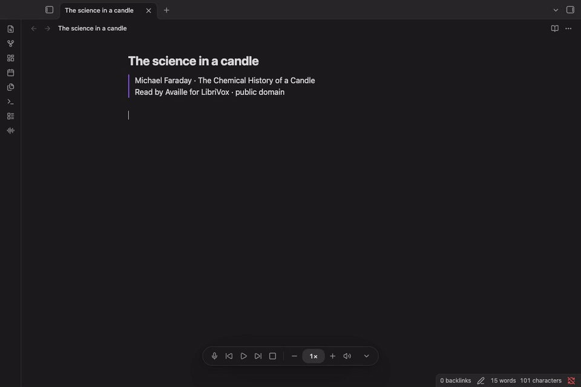

# Edge Voice

**Read your notes and PDFs aloud, or write them with your voice, in Obsidian.**

**Free. Private.** Open source (MIT), with no account, no subscription and no cloud. The voices and the speech recognition run on your own computer, so your notes and your voice never leave it.

▶ **[Watch the demo with sound](docs/media/demo.mp4)**

## What it does

- **Read along.** Listen to notes and PDFs while the sentence and each spoken word light up on the page.
- **Natural voices.** 66 English voices, American and British, from Kokoro and Piper.
- **Write with your voice.** Double-tap Left ⌘ (Left Ctrl on Windows and Linux) or click the microphone, and your words appear in the note as you speak. When you pause, the mic turns green and dictation stops on its own; or tap the key once to stop.
- **Start anywhere.** Right-click a sentence and choose _Start text-to-speech here_; pause, skip and change speed from the player bar.

▶ **[Watch the dictation demo with sound](docs/media/dictation.mp4)**

English only for now. Obsidian desktop only (macOS, Windows, Linux).

## Setup

1. Install **Edge Voice** from [Obsidian's Community plugins](https://community.obsidian.md/plugins/edge-voice) and enable it.
2. Edge Voice shows the setup commands for your computer, each with a Copy button. Run them once in Terminal (PowerShell on Windows). They install its small speech engine and the voice or dictation model you choose. Edge Voice itself never installs or downloads anything.
3. Back in Obsidian, click **Check again**, and press play.

[Full setup and update instructions](docs/setup.md)

## Is it safe?

- **No internet:** the plugin makes no network requests. No telemetry, no account.
- **It runs one program, its own speech engine,** directly, without a shell. That's what Obsidian's scan lists as "shell execution".
- **Microphone only while you dictate,** and audio is never saved. The clipboard is written only when you press Copy, and never read.
- **Verifiable:** Obsidian rebuilds every release from this source and checks it matches.

## Documentation

- [Setup and updates](docs/setup.md): install the engine, voices and dictation models; update later
- [Using Edge Voice](docs/using.md): commands, shortcuts, the player bar and settings
- [Dictation](docs/dictation.md): models, controls and troubleshooting
- [Voices](docs/voices.md): all 66 voices, with samples and sizes
- [Why read along](docs/why-read-along.md): the research on reading while listening
- [How it works and limits](docs/how-it-works.md)
- [Privacy, files and verifying downloads](docs/privacy.md)
- [Licences](docs/licenses.md) · [Media credits](docs/media/README.md)
- [Changelog](CHANGELOG.md) · [Security](SECURITY.md) · [Contributing](CONTRIBUTING.md)

Edge Voice is MIT licensed ([LICENSE](LICENSE)). The demo PDF is Wei et al., [_Chain-of-Thought Prompting Elicits Reasoning in Large Language Models_](https://arxiv.org/abs/2201.11903) (2022), CC BY 4.0; that recording was made on an Intel Mac with the pauses for synthesis cut. The dictation demo uses Faraday's _The Chemical History of a Candle_, read by Availle for LibriVox (public domain).
