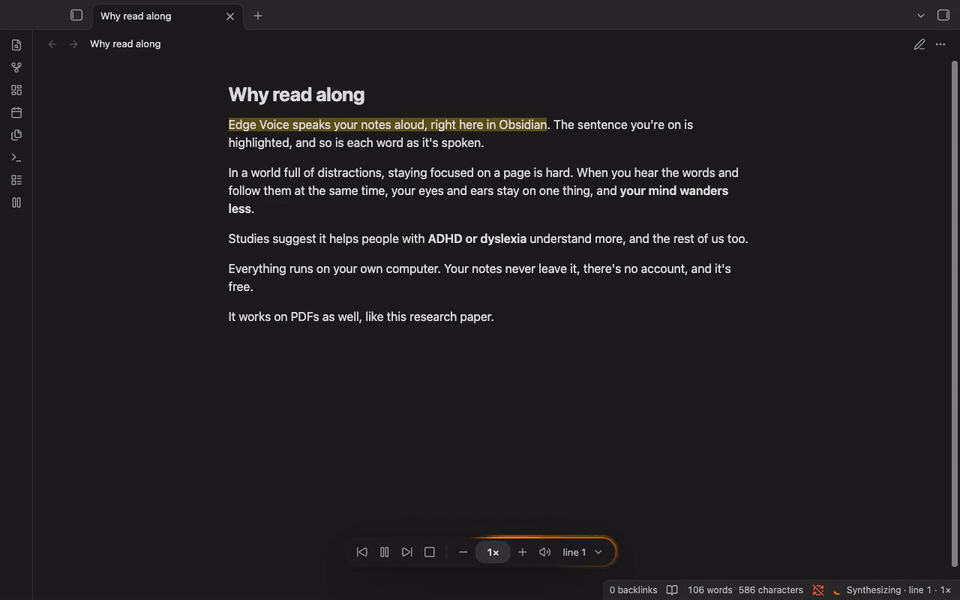
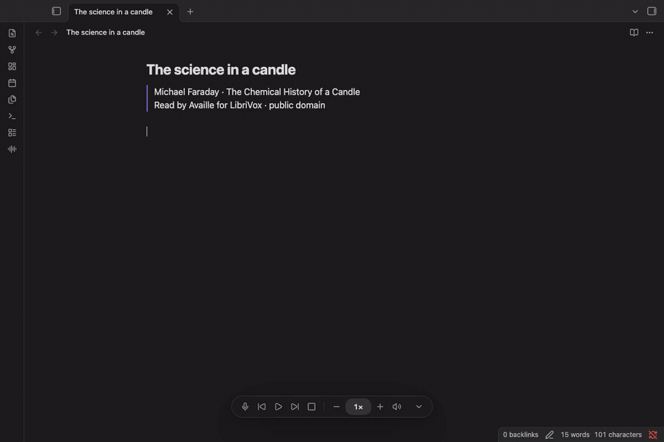

**Read notes and PDFs aloud, or write Markdown with your voice.** Edge Voice brings local text-to-speech (TTS) and English speech-to-text (STT) to Obsidian desktop.

**Free and private.** Open source (MIT), with no account, subscription or telemetry. Speech synthesis and recognition run on your own computer. Once the engine and chosen voice/models are installed, reading and dictation work offline.

### Read along

[Watch the TTS demo with sound](https://github.com/user-attachments/assets/fb9d0ba1-60dc-46e0-a5a7-1c8fc0d4d4ee)

- Follow sentence and word highlights in Markdown editing, Live Preview, Reading view and PDFs.
- Choose from 66 English Kokoro and Piper voices, with American and British options. Apple silicon Macs can use MLX for faster Kokoro TTS.
- Start at a sentence from the context menu; pause, skip, change speed and adjust volume from the player.

The TTS demo includes Wei et al., _Chain-of-Thought Prompting Elicits Reasoning in Large Language Models_ (2022), [CC BY 4.0](https://creativecommons.org/licenses/by/4.0/), [source](https://arxiv.org/abs/2201.11903). Pauses for synthesis on the Intel recording machine were removed.

### Write with your voice

[Watch the STT demo with sound](https://github.com/tattorba87/obsidian-edge-voice/blob/main/docs/media/dictation-dark.mp4) · [Light theme demo](https://github.com/tattorba87/obsidian-edge-voice/blob/main/docs/media/dictation-light.mp4)

- Dictate English at the cursor or replace selected text in a Markdown editor. Partial words can be revised until recognition finishes.
- Click the microphone to start and finish. Or double-tap **Left ⌘** on Mac (**Left Ctrl** elsewhere) to start, and tap once to stop. Reading uses the right key by default; both shortcuts offer matching symbolic presets and custom keys, with conflict checks.
- Keep the same player controls in both modes. Reading controls grey out during dictation; the microphone greys out during reading. The processing glow stays on until final text arrives, while the mic glow and three **Dictating** bars follow input volume and fall to zero when quiet.
- Choose English Moonshine Tiny, Small or Medium Streaming models, all MIT licensed. Optional start/stop sounds, lowercase output and an inactivity timeout are grouped in dictation settings.

The STT recording uses Michael Faraday's _The Chemical History of a Candle_, read by Availle for [LibriVox](https://librivox.org/the-chemical-history-of-a-candle-by-michael-faraday/) (public domain). Licensed audio is routed as microphone input to the real recognizer; text is uncorrected and the video runs in real time, including finalization. It demonstrates transcription rather than live microphone capture. [Credits and recording details](https://github.com/tattorba87/obsidian-edge-voice/blob/main/docs/media/README.md).

### Setup and updates

Install Edge Voice from Community plugins, then follow its setup commands to install the separate local Python speech engine. **The plugin installs and downloads nothing.** You run the commands yourself; packages and managed models use pinned versions and SHA-256 checks. For TTS, get a voice; for STT, get an English model. You can use either or both modes, one at a time.

Existing users keep their reading preferences and downloaded voices. Dictation is on for new installs; if you're updating, it stays off until you turn it on in settings. It requires engine **0.4.0 or later** and a separate model download. Obsidian's plugin update does not update Python: Edge Voice shows the installed engine version and offers manual setup steps when it is older than the bundled recommendation. This check is local and does not query a server.

[Setup and engine update instructions](https://github.com/tattorba87/obsidian-edge-voice#setup) · [Dictation guide and troubleshooting](https://github.com/tattorba87/obsidian-edge-voice/blob/main/docs/dictation.md)

### Privacy and limits

English only. Desktop Obsidian on macOS, Windows and Linux; no mobile support. Microphone access begins only when you start dictation. Audio is processed locally in memory and is not saved to recordings or transcript logs; the resulting words are saved in your note through Obsidian.

Dictation works in Source mode and Live Preview, not PDFs or Reading view. Stop and wait for final text before editing or switching notes. Live text can change, recognition can make mistakes and undo may step through partial results. The inactivity timer measures time since the transcript changed, rather than acoustic silence. MLX acceleration currently applies to TTS only.

Engine, voices and managed models live outside your vault. Downloads occur only through the setup/voice/model commands you run, from the sources listed in the [privacy documentation](https://github.com/tattorba87/obsidian-edge-voice#privacy-and-network-use). Models and voices retain their own licenses; [license details](https://github.com/tattorba87/obsidian-edge-voice/blob/main/docs/licenses.md).
